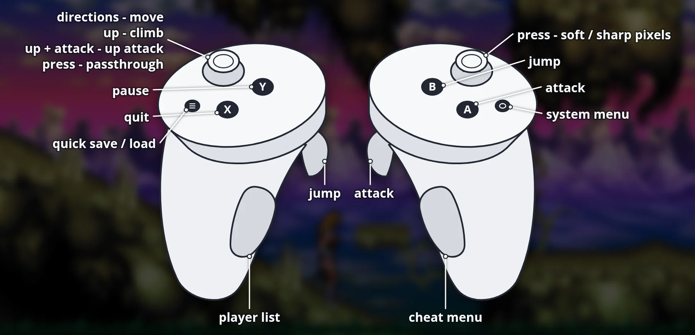

# Lionheart 3D - Lionheart Remake for Meta Quest

**Download, install guide, controls and pictures: [portroyale.online/lionheart.html](https://portroyale.online/lionheart.html)**

A standalone Meta Quest 3 / 3S / Pro / 2 port of [Lionheart Remake](https://github.com/b3dgs/lionheart-remake)
by Byron 3D Games Studio, the remake of Thalion's Amiga classic *Lionheart*.
The whole game is in the APK: no extra data, no PC needed.

## Features
- **Stereoscopic 3D:** every layer of the original parallax picture sits at its own depth: the sky far away, the
  middle backgrounds in between, the scrolling ground tilted into the distance, the playfield with Valdyn and the
  enemies on the screen, water/lava in front of it and the HUD closest to you.
- **Curved screen** around your head, 2.6 m wide at 2.2 m (adjustable).
- **Passthrough mode:** press the left stick to swap the game's sky and backgrounds for your room; the playfield
  floats in your room. The game remembers the mode.
- **Smoothed pixel art:** every layer is upscaled 4x with an edge-directed pixel-art scaler, then sharpened.
  Press the right stick to switch between the soft picture and the original sharp pixels (remembered).
- **Sharp text:** menus, messages and the info line are drawn at high resolution.
- **Quick save / load menu:** the menu button opens it in a level: 5 save slots at your last checkpoint, plus the
  automatic save at every level start. The main menu's *Continue* works on Quest too.
- **Two-button controls:** only B / left trigger jump, stick up climbs and aims upward attacks.
- 72 FPS, Touch controllers mapped onto the game's own gamepad support.

## Install
1. Enable developer mode for your headset (Meta Horizon app > Devices > Developer mode).
2. Install `Lionheart-3D-v0.2.0-beta.apk` with SideQuest or `adb install -r Lionheart-3D-v0.2.0-beta.apk`.
3. Start **Lionheart 3D** from the app library (*Unknown sources*).

## Controls



| Touch | Game |
|---|---|
| Left stick | move Valdyn / menu selection (up = climb, up + attack = upward attack) |
| Right trigger or A | attack / confirm |
| Left trigger or B | jump |
| Menu button | quick save / load menu (in a level) |
| Left stick click | passthrough on/off |
| Right stick click | soft picture / sharp pixels |
| Y | pause |
| X | quit / back |
| Left grip | player list (Tab) |
| Right grip | cheat menu |

Quick menu: stick up/down chooses a slot, stick left/right switches between LOAD and SAVE, A confirms,
B closes. The game's *Options → Joystick* still offers the original one-button mode (stick up jumps).

## Settings
Optional: copy [`vr.cfg.example`](vr.cfg.example) to the headset as
`/sdcard/Android/data/com.b3dgs.lionheart.quest/files/vr.cfg` to change screen size/distance, curve, 3D depth,
smoothing and sharpening. Restart the game afterwards.

## Building from source
Branch `quest-vr`, app in `java/lionheart-quest`. LionEngine snapshots are not published, so install them into the
local Maven repository first (JDK 17, Maven 3.9, Android SDK with NDK 27.2 and CMake 3.22.1):

```sh
git clone https://github.com/b3dgs/b3dgs-buildtools && (cd b3dgs-buildtools && mvn install -DskipTests -Dgpg.skip)
git clone https://github.com/b3dgs/b3dgs-parent && (cd b3dgs-parent && mvn install -DskipTests -Dgpg.skip)
git clone https://github.com/b3dgs/lionengine && (cd lionengine && mvn install -DskipTests -Dgpg.skip \
    -pl java/lionengine-core,java/lionengine-game,java/lionengine-helper,java/lionengine-audio-sc68 -am)
# this repository, branch quest-vr: the game module (with the stereo layer hooks)
mvn install -DskipTests -Dgpg.skip -pl assets,java/lionheart-game -am
cd java/lionheart-quest && echo "sdk.dir=$ANDROID_HOME" > local.properties && ./gradlew assembleRelease
```

The port is a small layer on top of the remake:
- `java/lionheart-quest/app/src/main/cpp/lionheart_xr.c`: OpenXR host (session, eye rendering of the layers,
  curved screen, Scale2x, passthrough, Touch input). The OpenXR lifecycle follows
  [QuakeQuest](https://github.com/DrBeef/QuakeQuest).
- `java/lionheart-quest/app/src/main/java/com/b3dgs/lionengine/android`: LionEngine's Android backend, vendored and
  patched (offscreen surface, layer capture, gamepad input, alpha fix).
- `java/lionheart-game/.../StereoLayers.java` + `landscape/BackgroundStereo.java`: hooks that mark the depth layers
  (no effect on the PC/Android builds). Re-apply with `java/lionheart-quest/tools/apply_stereo_hooks.py`.

## Credits and licence
- Lionheart Remake and LionEngine: Pierre-Alexandre / [Byron 3D Games Studio](https://lionheart.b3dgs.com), GPL-3.0.
- Original *Lionheart* (1993): Thalion Software.
- Quest port: Sgt.Bilko, GPL-3.0 like the remake.
